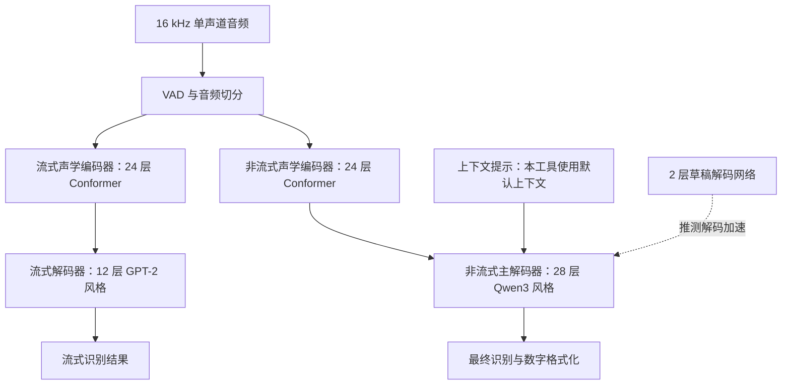

# Doubao Offline ASR Lab

在 Apple Silicon Mac 上使用本机提取的豆包原版离线权重进行语音识别。本仓库提供两条运行路径：

| 版本 | 推理实现 | 录音页面 | 当前状态 |
|---|---|---|---|
| **独立 MLX 实验版** | 我们编写的 NumPy + MLX 算子，不加载豆包私有库 | `localhost:8766` | 短音频端到端已跑通，最多 18 秒 |
| 原运行库版本 | 将本机提取的豆包推理实现装入独立进程 | `localhost:8765` | 保留用于测试与对照 |

**非官方研究项目，不是豆包 SDK，也不是重新训练的开源模型。** 仓库只公开实现代码和文档，不包含权重、安装包、私有库或原程序中的算子源码。权重需要从使用者自己的受支持版本安装中提取。

## 独立 MLX 为什么不需要豆包私有库

提取与推理是两个阶段：

1. **一次性提取**：导出器调用 `independent/extract.py` 读取本机安装的程序与模型，校验版本哈希，恢复 payload 的 XOR 混淆。中间 `plain.model` 放在临时目录，转换完成后自动清理。该过程不执行原程序、不生成或加载 `runtime.bundle`。
2. **无损转换**：`independent/export.py` 将非流式路径所需张量写入三个 safetensors 文件，同时保存图配置、词表、提示词和 CMVN。逐张量校验 dtype、shape 和字节完全一致；运行时由 `model_source.py` 直接加载导出目录，不解析或读取 FLUTE。
3. **独立计算**：NumPy 完成音频特征提取，MLX 执行两层卷积、24 层 Conformer、音频投影及 28 层主解码器。BPE 词表和提示模板从本地包读取，最后处理数字转写标注。

```text
本机豆包安装文件 ──提取/转换──> exported-model/（safetensors + 配置）
                                      │
录音 ──> NumPy 特征提取 ──> MLX 编码器 ──> MLX 解码器 ──> 文字
```

推理时不需要输入法进程或原安装目录，也不调用豆包服务。网页的推理子进程在沙箱内运行，禁止联网及读取原输入法、`runtime.bundle`、`helper.dylib` 和旧版私有 Frameworks。MLX 和 macOS Metal 系统库仍是运行依赖。

**独立的是推理实现和运行容器，模型参数仍来自豆包。** 导出后只需 `exported-model/`，不再需要原安装文件或任何 FLUTE 包；转换不改变参数来源或再分发权限。若连参数来源也要独立，需要使用许可合适的其他模型或另行训练。导出保留自定义 INT4 排列，并非可以直接交给 Transformers 的标准 Qwen3 checkpoint。

本原型将 INT4 解包为 FP32，使用浮点激活；尚未完成与原库整数算子的逐层数值对齐，不保证结果或内存占用与原版一致。草稿解码器、流式路径和 VAD 尚未接入独立版。

## 独立 MLX 安装与录音

已验证环境：Apple Silicon、macOS 26.2、Python 3.13、MLX 0.32.4。其他系统版本尚未验证。先安装受支持版本的豆包输入法，并下载离线模型（本次分析为模型目录 `1_8`）；提取脚本会校验程序和模型哈希，不支持的版本会直接报错。

```sh
git clone https://github.com/shelly-tang/doubao-offline-asr.git
cd doubao-offline-asr
python3 -m venv independent/.venv
independent/.venv/bin/python -m pip install -r independent/requirements.txt
independent/.venv/bin/python independent/export.py
independent/.venv/bin/python independent/web_server.py
```

打开 <http://localhost:8766>，允许麦克风后点击开始录音。建议 5–15 秒，页面在 17 秒自动停止，后端最多接受 18 秒。停止后显示识别结果、加载时间和处理时间。每次请求重新加载模型；没有 VAD 自动断句或边说边出字。

默认导出目录是约 470.8 MB 的 `independent/exported-model/`，包含三个 safetensors、JSON 图配置和文本资产。脚本拒绝覆盖已有目录；已经成功导出过就跳过导出步骤。旧用户可通过 `independent/export.py --pack independent/plain.model` 直接转换已有包。依赖安装需要联网，模型不从远程下载。独立版不需要执行根目录的 `prepare.py`、`repack.py` 或 `build.py`。

命令行接受单声道 16 kHz PCM16 WAV：

```sh
independent/.venv/bin/python independent/transcribe.py independent/exported-model input.wav
```

[完整独立版文档](independent/README.md)包含采样率转换、禁止私有库访问的验证命令、缓存一致性检查、实现文件和限制说明。

## 独立 MLX 实测结果

以下均为本机开发测试，非准确率评测或稳定性能基准；还没有真人语音准确率结论。

| 输入 | 输出 | 观测耗时 |
|---|---|---|
| 约 5.92 秒合成语音 | 你好，今天下午3点开会，请帮我准备15份会议材料。 | 首次端到端约 4.67 秒，含加载 |
| 约 6.10 秒新生成的合成语音 | 明天早上8:30，请提醒我带上雨伞，坐地铁去图书馆。 | CLI 约 4.58 秒，含加载 |
| 同一第二段音频，经录音页面后端提交 | 同上 | 请求总等待 3.60 秒；模型加载 1.76 秒，其余处理 1.56 秒，另有请求/进程启动开销 |
| 两秒全零 PCM | 空文本 | 约 1.92 秒，含加载 |

第二段和静音测试在禁止联网、读取豆包程序及私有库的沙箱中完成。28 层解码器的 FP32 整段输入与逐 token 缓存计算最大差值约 `5.5e-5`，这是本实现内部一致性检查，不是与豆包原库的对齐结果。提取包与旧版 plaintext pack 的 SHA-256 一致，九个子模型的张量尺寸检查通过。

### safetensors 转换一致性（2026-11-15）

本机提取并转换后，1,314 个张量的 dtype、shape、字节内容逐一一致。使用同样两段合成语音和两秒静音比较两种加载路径：

| 样本 | 生成 token 数 | token ID / 原始文字 / 最终文字 | 编码器最大绝对误差 |
|---|---:|---|---:|
| 开会与材料 | 47 | 完全一致 | 0 |
| 雨伞与图书馆 | 35 | 完全一致 | 0 |
| 两秒静音 | 0 | 完全一致 | 0 |

safetensors 路径测试额外禁止读取所有 `.model` 文件，仍正常完成。另有 5 项无权重格式测试通过，覆盖损坏文件、缺失资产、版本检查等。以上证明本次转换保持已有 MLX 路径行为，不表示与豆包原库逐算子等价，也不代表真人准确率评测。

[导出格式、可复现验证命令与迁移说明](independent/SAFETENSORS.md)。公开提交只包含代码和说明，不包含导出目录、词表、提示模板或权重。

## 原运行库版本与模型解析资料

以下安装、录音、性能和宿主加载说明描述的是**复用私有运行库的原版本**，独立 MLX 使用上面的入口。模型结构和包格式分析为两条路径提供共同依据。

## 目录

- [当前能做什么](#当前能做什么)
- [模型架构](#模型架构)
- [解析与独立运行过程](#解析与独立运行过程)
- [本地安装](#本地安装)
- [网页录音测试](#网页录音测试)
- [命令行转写](#命令行转写)
- [速度指标与验证结果](#速度指标与验证结果)
- [本地数据处理](#本地数据处理)
- [文件说明](#文件说明)
- [常见问题](#常见问题)
- [限制与许可](#限制与许可)

## 当前能做什么

已在 Apple Silicon Mac 上验证：

- 独立命令行进程加载原版权重，不需要启动输入法界面或连接输入法进程。
- 调用原版 Panther 推理实现，加载 VAD、流式与非流式识别组件。
- 实际运行非流式解码和草稿推测解码，得到最终转写结果。
- 通过浏览器录音，停止后自动识别，显示耗时，并支持回放和复制文字。
- 推理子进程在禁止联网的系统沙箱中运行，同时禁止访问原输入法安装目录及用户输入法数据目录。

当前网页是**录完再识别**，不是实时字幕。每次识别启动一个新进程、重新加载模型，结束后退出。

## 模型架构

以下结论来自本机 **豆包输入法 1.1.0 / 离线资源 1.8** 的配置和模型计算图解析，参数量为重建估算，不是厂商公布值。内部配置版本为 `LiteASRP_v1.1.2_6`。



这是组件关系示意，不代表已确认输入法产品在所有模式下都同时执行两条分支。

| 组件 | 解析到的结构 | 逻辑参数量，约 |
| --- | --- | ---: |
| 流式声学编码器 | 24 层 Conformer；维度 880；8 个注意力头；FFN 3072；chunk 4 | 399.05M |
| 流式语言解码器 | 12 层 GPT-2 风格；维度 1024；16 个注意力头；FFN 4096；GELU；词表 64000；含词嵌入和位置嵌入 | 218.79M |
| 非流式声学编码器 | 24 层 Conformer；维度 880；8 个注意力头；FFN 3072；chunk 100 | 399.05M |
| 非流式主语言解码器 | 28 层 Qwen3 风格；维度 1024；16 Q / 8 KV 头；head dim 128；FFN 3072；SiLU；词表 64000；含共享词嵌入 | 506.00M |
| 草稿解码器 | 2 层 Qwen3 风格计算块与 2048→1024 投影；不重复计共享词嵌入 | 33.56M |
| VAD | 卷积、3 个 SLSTM 算子等 | 约 0.29M |

按包内分别存储的组件计算，总计约 **1.557B（15.57 亿）逻辑参数**。流式主路径约 617.84M，非流式主路径约 905.05M，另有草稿网络和 VAD。总计没有做跨模型数值去重，也不表示每个 token 都要执行全部参数。

参数量依据张量维度和 4-bit 打包权重重建，排除量化 scale、zero-point、KV 状态和 RoPE 预计算表等。主要权重为 4-bit 打包，部分算子和张量采用其他精度；`W4A8` 算子名称不能证明所有后端的激活都以相同精度执行。

### Qwen3、草稿解码与 VAD 分别意味着什么？

- **Qwen3 风格结构已确认**：非流式主图中有 28 个 `W4A8ImeAsrQwen3TransformerBlock`，草稿图中有 2 个。不能据此证明权重直接从官方 Qwen3-0.6B 继续训练而来；训练记录和权重来源没有得到确认。
- **草稿网络用于推测解码**：配置为 `draft_len: 2`、`draft_layer_num: 2`，实测日志出现 `[SpecDecoder] draft loaded` 和 `draft-batch`。它不是另一套能够独立听声音的完整 ASR。是否采用 MTP 训练，目前不能确认。
- **VAD 用于判断语音活动与切分**：单独模型约 1.16 MB、29 万参数。当前页面停止录音后才将音频送入引擎；内部 VAD 会执行，但页面没有实现“检测静音后自动停止录音”。

模型支持的上下文提示字段包括改词、对话、热词和光标附近文本。**本工具不采集或提供这些个人上下文**，使用默认提示。模型支持某字段，也不能证明原输入法一定会从宿主应用读取并传入该字段。

## 解析与独立运行过程

### 1. 识别容器与资源边界

原模型文件为 824,999,405 字节，使用 `FLUTE` v3 容器。已解析的布局包括 5 字节 magic、版本号、头部长度与文件数量；该包头部为 1143 字节，包含 20 个内部文件。

目录头和文件内容采用不同编码方式：目录头存在 ChaCha20 解密路径，文件 payload 使用逐文件 XOR 编码。

**没有成功解密原版 v3 目录头。** 独立调用目录解密路径依赖应用注册回调，在实验中未成功。后续提取依靠恢复 payload 编码、文本边界和 Panther FlatBuffer 图边界完成，并非完整还原了原容器的加密目录。

### 2. 恢复 payload 并验证计算图

从静态加载代码恢复了逐文件解码规则：

```text
plain[i] = encoded[i] XOR key[i % 8] XOR (i & 255)
```

`i` 在每个内部文件起点重新计数。脚本从指定版本的本机二进制中恢复所需编码参数，不需要用户输入账号密钥。

分析时恢复的 20 个 payload 段连续覆盖文件头之后的全部内容。解析了 9 个模型计算图，并通过节点类型、张量维度及配置引用对应文件角色。流式编码器、流式解码器、词嵌入、位置嵌入和 VAD 的 MD5 与包内清单匹配；非流式三个模型与较早清单不一致，草稿模型未列入该清单，不能声称所有组件都通过了原清单校验。

仓库的 [components.json](components.json) 保留九个模型的偏移、大小、MD5 和算子统计；不包含权重值。当前 `repack.py` 是针对该版本的定址提取器，**不是可处理任意 FLUTE 文件的通用解析器**。

### 3. 将原推理实现装入独立进程

推理代码主要静态链接在应用主程序中，没有可直接拿来调用的独立 ASR 动态库。

[prepare.py](prepare.py) 校验原程序 SHA-256，提取 arm64 部分，并将**本地副本**转换为可由命令行加载的 Mach-O bundle。保留重定位需要的段索引，调整入口相关加载命令并重新做本地签名。副本中跳过三个会导致独立宿主退出的混淆初始化函数，并用占位库替换一个没有导入符号引用的宿主辅助库。

这些初始化函数的全部作用尚未完整解释。此方法是特定版本的实验适配；原安装文件未被修改，系统安全设置未被关闭。

### 4. 重封装权重并调用识别接口

[repack.py](repack.py) 将恢复的九个原版模型以及配置、分词器和特征参数，共 15 个必要资源，重新封装为运行时支持的 FLUTE v1 明文容器 `plain.model`。使用的是原权重数值，没有重新训练。特征归一化使用包内的 CRLF 格式 CMVN 文件；同包另有 LF 副本。

[run.mm](run.mm) 使用当前版本的固定地址调用 `FluteManager` / `FluteAsr`：创建引擎 → 加载资源 → 创建执行器 → 开始识别 → 按 100 ms 音频块送入 → 发送结束标记 → 获取最终结果。

这条路径已经运行成功，但仍依赖复制到本地的原版 Panther 和配套框架，不是 PyTorch 重写，也不是厂商公开接口。

## 本地安装

### 环境要求

| 项目 | 要求 |
| --- | --- |
| 系统与芯片 | macOS / Apple Silicon；未验证 Intel Mac、Linux 或 Windows |
| 开发工具 | Xcode Command Line Tools，提供 `clang` / `clang++` |
| Python | Python 3，能够安装 `requirements.txt` 中的 NumPy |
| 本机应用 | 下述 SHA-256 对应的豆包输入法 1.1.0 |
| 离线资源 | 版本 1.8，位于脚本指定路径 |
| 磁盘空间 | 构建产物约 1 GB，另需保留本机原安装与模型；建议预留至少 2 GB 额外空间 |

只有版本号相同还不够：程序哈希和模型资源也必须对应。脚本不会下载豆包安装包、下载模型、登录账号或自动适配新版程序。

### 1. 准备本机应用与模型

自行安装允许使用的豆包输入法版本，通过其设置下载离线语音模型。构建脚本读取以下位置：

```text
/Library/Input Methods/DoubaoIme.app/Contents/MacOS/DoubaoIme
/Library/Input Methods/DoubaoIme.app/Contents/Frameworks/
~/Library/Application Support/DoubaoIme/ASRModel/versions/1_8/asr_model.model
```

构建前检查文件摘要：

```sh
shasum -a 256 '/Library/Input Methods/DoubaoIme.app/Contents/MacOS/DoubaoIme'
shasum -a 256 "$HOME/Library/Application Support/DoubaoIme/ASRModel/versions/1_8/asr_model.model"
```

预期值：

```text
程序：5b48748fa6394811cba0f8c05905ffebb9a2cd02faf6d47b26deb3d9b86247e0
模型：786d0ac0c8d14f451830589f408ec113385433086eea6e693a21cf0c6281d223
```

程序摘要由 `prepare.py` 自动校验；**模型摘要目前需手动核对**，因为 `repack.py` 使用固定偏移。摘要不匹配时不要删除程序校验或直接套用这些偏移。

### 2. 获取项目并准备依赖

如未安装命令行开发工具，先运行 `xcode-select --install`，在系统窗口中完成安装。然后：

```sh
git clone https://github.com/shelly-tang/doubao-offline-asr.git
cd doubao-offline-asr
python3 -m venv .venv
source .venv/bin/activate
python3 -m pip install -r requirements.txt
```

### 3. 构建本地运行包

```sh
python3 build.py
```

构建会在项目目录创建 `runtime.bundle`、`Frameworks/`、`helper.dylib`、`run`、`plain.model` 和 `offline.sb`，不覆盖原输入法安装。模型文件约 825 MB，配套程序与框架约 236 MB；文件大小与磁盘实际占用可能不同。

这些生成文件均在 `.gitignore` 中，不应提交到仓库。构建完成提示中的 `test.wav` 只是示例文件名，仓库不附带测试录音。

## 网页录音测试

在项目目录、虚拟环境已激活的终端运行：

```sh
python3 web_server.py
```

浏览器打开 [http://localhost:8765](http://localhost:8765)，按以下流程测试：

1. 点击 **开始录音**，首次使用时允许浏览器访问麦克风。
2. 自然说一段话，建议先测 5–20 秒。电平条应随声音变化。
3. 点击 **停止并识别**。录音最长两分钟，到时会自动停止并开始识别。
4. 等待模型加载与转写完成，查看文字和四项时间指标。
5. 使用音频播放器回放原录音，核对错字；需要时点击 **复制文字**。
6. 再次点击 **开始录音** 可进行下一轮测试。停止服务器，在终端按 `Ctrl+C`。

可用包含数字、日期和专有名词的句子比较效果，例如：“明天下午三点半开会，请准备十五份材料。”也可以分别测试安静环境、轻微背景噪声和自然停顿。项目没有提供真实人声准确率基准。

构建后也可双击 `启动录音测试.command`，它会打开浏览器并启动服务器；若终端提示没有权限，在项目目录执行 `chmod +x 启动录音测试.command`。同一端口只需启动一个服务。

录音使用浏览器选择的默认麦克风，并请求浏览器的回声消除与降噪。实际是否启用由浏览器和设备决定。当前没有麦克风选择器；可在浏览器或 macOS 设置中切换设备。

## 命令行转写

```sh
# 输出最终文字
python3 transcribe.py /absolute/path/audio.wav

# 输出完整 JSON
python3 transcribe.py /absolute/path/audio.m4a --json

# 将诊断日志保存到指定位置
python3 transcribe.py /absolute/path/audio.wav --json --log recognition.log
```

工具使用 macOS 自带的 `afconvert` 将输入转为 **16 kHz、单声道、16-bit PCM**，可处理的输入格式取决于本机 `afconvert`。它不会自动安装其他音频解码器。

CLI 的识别子进程超时为 180 秒；网页外层请求超时为 190 秒。长录音或较慢设备可能超时，建议先用短音频验证。

## 速度指标与验证结果

| 页面指标 | 含义 |
| --- | --- |
| 录音时长 | 实际送入服务的音频长度 |
| 模型加载 | 加载运行库、权重及执行器，并开始识别会话的时间 |
| 识别计算 | 送入全部音频、执行流式处理、结束后的非流式解码及读取最终结果的时间 |
| 停止后总等待 | 服务端处理请求的总耗时，包含输入读取、转换、进程启动、加载和识别；不含浏览器封装录音等前端开销 |

页面同时显示 **实时率 RTF = 识别计算耗时 / 音频时长**；例如 RTF 0.16 表示计算耗时约为音频长度的 16%。显示的“倍实时速度”为其倒数，不含模型加载时间，也不等于录音过程中的出字延迟。

一次通过网页后端接口进行的固定合成音频测试：

| 项目 | 实测值 |
| --- | ---: |
| 音频时长 | 5.916 秒 |
| 模型加载 | 1.649 秒 |
| 识别计算 | 0.947 秒 |
| 服务端总等待 | 3.485 秒 |

测试音频由 macOS 的 Tingting 声音合成，转写为：

> 你好，今天下午3点开会，请帮我准备15份会议材料。

日志显示原版后端启用了 Metal，并运行草稿推测解码。这只是单机、单样本验证；不同设备、缓存状态、音频长度与内容会影响速度，不能代表普遍性能或真实人声准确率。运行时内存占用尚未实测。

## 本地数据处理

- 网页只与 `127.0.0.1:8765` 的本机服务通信，服务不监听局域网地址；没有外部网页资源或云端识别请求。
- 服务检查请求的 Host / Origin、限制请求大小，并只允许一次执行一个识别任务。
- 推理子进程使用生成的 `offline.sb`，禁止网络访问以及原应用和用户输入法目录访问。它仍需读取项目中的运行副本和临时音频；这不是对所有文件访问的全面隔离。
- 网页服务正常完成或报错退出请求时，会删除临时音频与诊断文件。强制杀死服务等异常情况可能留下系统临时目录。
- 浏览器保留当前录音供回放，开始识别下一段后替换，关闭页面后不再保留。页面没有将录音写入浏览器持久化存储。
- CLI 仅在指定 `--log` 时保存引擎日志，日志可能包含转写文字。复制结果会写入系统剪贴板。
- 构建期间只读取安装文件和模型；本工具不采集输入框文字、历史对话或改词记录。

## 文件说明

| 文件 | 用途 |
| --- | --- |
| `build.py` | 编排本机构建、复制依赖、编译入口、生成沙箱配置 |
| `prepare.py` | 校验并适配指定版本的程序副本 |
| `repack.py` | 按已恢复边界提取并重封装模型资源 |
| `components.json` | 九个模型组件的偏移、大小、MD5 与算子统计 |
| `helper.c` | 独立宿主适配所需的辅助占位库 |
| `run.mm` | 调用原版引擎的 Objective-C++ 入口 |
| `transcribe.py` | 文件格式转换、隔离运行和结果输出 |
| `web_server.py` | 仅监听本机的录音识别服务 |
| `web/index.html` | 录音、回放、识别结果和计时界面 |
| `启动录音测试.command` | macOS 双击启动入口 |

## 常见问题

**提示 `Unsupported app binary version`。**

当前安装程序与支持的哈希不同。固定地址与布局不能跨版本保证有效，不能通过删除校验解决。需要针对新版本重新分析和适配。

**找不到 `asr_model.model`。**

先确认输入法已下载离线语音资源，并核对上述 `versions/1_8/` 路径。其他资源版本不能直接改名冒充 1.8。

**提示没有 NumPy、编译器或构建失败。**

确认已激活 `.venv`、安装 `requirements.txt`，并完成 Xcode Command Line Tools 安装。应先成功运行 `build.py`，再启动页面。

**页面提示麦克风权限未开启，或电平不动。**

检查浏览器站点权限，以及 macOS“系统设置 → 隐私与安全性 → 麦克风”中的浏览器权限。确认默认输入设备正确。若内嵌浏览器不支持麦克风，使用常规浏览器访问本机地址。

**出现 `Address already in use`。**

端口 8765 已有服务。先尝试打开已有页面；如需重启，在原服务器终端按 `Ctrl+C`，再运行启动命令。

**`sandbox-exec` 报 `Operation not permitted`。**

嵌套沙箱或受限执行环境可能不允许创建子进程沙箱。尝试从普通 macOS 终端运行本工具；不需要关闭系统安全设置。

**为什么有 VAD，还要手动停止？**

当前录音页面不会实时把音频送入 VAD，而是在停止后送入完整音频。VAD 已在引擎内部使用，但尚未接成基于静音的实时结束检测。

**为什么第一次等待比“识别计算”长？**

每次请求都重新启动进程并加载模型，此外还有音频转换和启动开销。当前没有常驻模型服务，不能只用识别计算时间代表用户总等待。

## 限制与许可

- 原运行库版本绑定指定版本的私有二进制布局；独立 MLX 的提取脚本也限定已验证的安装文件版本。两者均不保证其他版本或平台兼容。
- 识别入口是以进程退出回收模型和线程的实验程序，尚未整理为可长期复用的 SDK。
- 没有复现输入法的个人词库、上下文采集、音频增益或全部产品后处理，结果不保证与输入法产品完全一致。
- 没有系统评估真实人声、方言、噪声、长音频或长期稳定性。
- 本仓库原始工具代码与文档采用 [MIT License](LICENSE)。许可证不覆盖豆包的权重、私有库、应用二进制、商标或这些资产的生成副本。
- 请自行确认本机第三方软件与模型的使用条件。本仓库不提供这些文件的下载或再分发授权。
